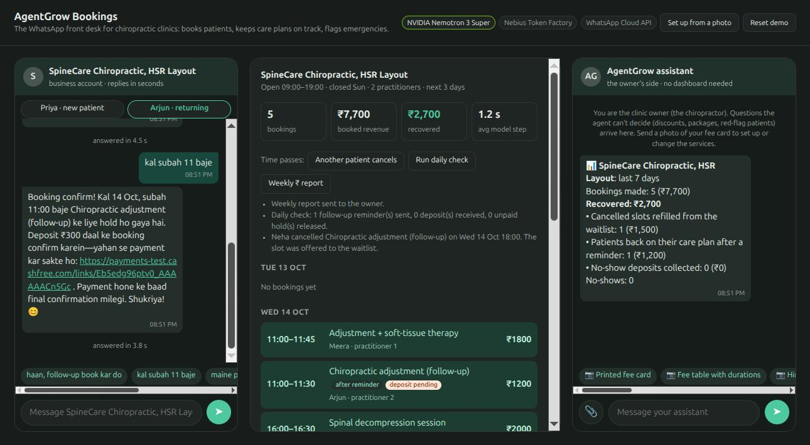
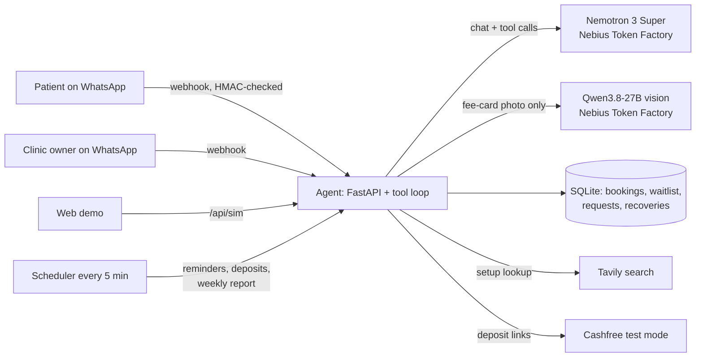

# AgentGrow Bookings: the WhatsApp front desk for chiropractic clinics

> Submission to the [Nebius x NVIDIA Global AI Hackathon 2026](https://nebiusglobalaihackathon.devpost.com), **Track: Best Apps & Agents**.
> License: [Apache 2.0](LICENSE). Built from scratch between 13 and 30 Oct 2026.

**Live demo (no login): https://bookings.agentgrow.io/demo** · **Video (< 3 min):** _link added at submission_



Small chiropractic clinics in India run their front desk on WhatsApp, by hand. The doctor is mid-adjustment while
messages pile up. Cancelled slots stay empty, patients quietly drop out of their care plan, and every missed visit
is lost income. Now and then a message describes numbness after a fall, which needs an emergency room, not a booking.

AgentGrow Bookings is an agent that answers the clinic's WhatsApp. **NVIDIA Nemotron 3 Super on Nebius Token Factory**
does all of the reasoning and tool calls:

- **Books, moves and cancels appointments** in English, Hindi or Hinglish ("kal shaam 6 baje adjustment ho jayega?").
  Availability and double-booking are enforced by the database, never by the model.
- **Keeps patients safe.** Red-flag symptoms are never booked: the doctor is alerted and the patient is sent to
  emergency (112). New patients start with a consultation. It never gives medical advice.
- **Sets itself up from one photo.** The owner sends a photo of the fee board. A vision model on Token Factory reads it,
  Nemotron confirms the list with the owner in chat, and a **Tavily** search prefills the address and hours.
- **Keeps the doctor in charge, inside WhatsApp, with no dashboard.** Anything outside the rules (a package discount, a
  red flag) goes to the owner's phone. The owner's reply ("haan, 10% de do") reaches the waiting patient, in the patient's language.
- **Wins back revenue and reports it in rupees.** A cancelled slot is offered to the waitlist. Patients who are overdue
  for their follow-up get a reminder. After a no-show, the next booking needs a ₹300 deposit (Cashfree, test mode). Every Monday the owner gets
  *"Recovered: ₹2,700"*.

## Try it in 2 minutes

Open the [demo](https://bookings.agentgrow.io/demo). It has three panes: the patient's WhatsApp, the clinic's live
schedule, and the owner's WhatsApp. Every message runs the same agent that answers real WhatsApp messages, against your
own sandbox clinic. **Reset demo** starts over.

1. As **Priya** (a new patient), tap *"kal shaam 6 baje appointment chahiye, pehli baar aa rahi hoon"*. 6 pm is full,
   so she is offered nearby times or the waitlist. Tap *"haan, waitlist pe daal do"*.
2. Under **Time passes**, press **Another patient cancels**. Priya is offered the freed slot. Tap *"haan, book kar do"*,
   and *₹ recovered* goes up.
3. Press **Run daily check**. **Arjun** (overdue for his follow-up) gets a reminder. Tap *"haan, kal subah 11 baje book kar do"*: because he once
   missed an appointment, the slot is held until a ₹300 deposit is paid. The link is a real Cashfree **test-mode** page
   (pay with one of the test cards or test UPI IDs from Cashfree's sandbox docs; no real money moves).
   Within a few seconds the booking shows *deposit paid*.
4. As Priya, tap *"6 sessions ke package pe discount milega?"*. The question appears in the owner's phone. Reply
   *"haan, 10% de do"* and watch the answer reach Priya.
5. As Priya, tap *"gir gayi thi, pair mein numbness hai"*. There is no booking, she is sent to emergency, and the
   doctor is alerted.
6. Press **Weekly ₹ report**, or ask the owner assistant *"is hafte kitna recover hua?"*.
7. Press **Set up from a photo**, then tap a 📷 sample fee card (or upload your own). Correct one price, reply *ok*,
   and the new clinic can take bookings.

The real thing runs on WhatsApp. Meta's test number can only message pre-registered phones, so judges use the web demo,
which runs the identical agent code.

## How it works



- **One agent loop, two roles.** The same Nemotron model answers patients (the receptionist prompt, with clinic safety
  rules) and the owner (the assistant prompt), with different tool sets. Patient tools: `list_services`, `find_slots`, `book`,
  `my_bookings`, `cancel_booking`, `join_waitlist`, `ask_owner`. Owner tools: `day_schedule`, `answer_request`, `set_menu`,
  `lookup_business` (Tavily), `update_business`, `mark_no_show`, `revenue_report`.
- **The model proposes, the code decides.** Slots are computed in SQL. Bookings run inside `BEGIN IMMEDIATE` with a unique index per
  practitioner and start time, so two patients can never get the same slot (an 8-thread race test checks this). Past times,
  closed days, a second booking of the same treatment on the same day, and another patient's booking are all refused by the tools.
- **Messages the clinic starts are agent turns too.** Owner answers, waitlist offers, reminders and deposit
  confirmations are written by Nemotron from a system note, so they come out in each patient's own language. Patients
  cannot forge those notes.
- **Every model call is logged** (model, tokens, latency) and shown live on the demo board.

## NVIDIA models and Nebius services used

| What | Model / service | Why |
|---|---|---|
| Every conversation, tool call and decision (patients and owner) | **NVIDIA Nemotron 3 Super** (`nvidia/nemotron-3-super-120b-a12b`) on **Nebius Token Factory** | Best of the Nemotron family on our clinic eval: 22/22 at 3.1 s per turn (below) |
| Reading a fee-card photo into a service list | `Qwen/Qwen3.8-27B` on Nebius Token Factory | Token Factory has no NVIDIA vision model yet. This call only transcribes; Nemotron does everything else |
| Business lookup during setup | Tavily Search API | Prefills address, hours and website for the owner to confirm |

We chose the model with an eval rather than by guessing. Token Factory is OpenAI-compatible, so swapping a model is
one environment variable, and we could run the same scripted scenarios against every NVIDIA model in an afternoon.
`eval/run.py` drives the real agent through 11 clinic scenarios with a frozen clock and judges the **database state**
(was the right slot booked? was the owner alerted?), never the wording:

| Model (Token Factory) | Pass | Seconds per turn | USD per 1,000 conversations |
|---|---|---|---|
| **Nemotron 3 Super 120B-A12B** | **22/22** | **3.1** | **2.13** |
| Nemotron 3 Nano 30B-A3B | 21/22 | 16.2 | 1.21 |
| Nemotron 3.5 Lightning | 20/22 | 1.4 | 0.47 |

At about **$0.002 (≈ ₹0.18) per conversation**, plus about $0.002 per fee-card photo, the model bill for a busy clinic is a
few hundred rupees a month. The eval also caught real bugs before users did: Lightning once said "cancelled" without
cancelling. A prompt change once made Super skip the doctor alert on a red flag; it is fixed and re-verified.
Details: [`eval/README.md`](eval/README.md). Fee-card reading: Qwen3.8-27B read 3 of 3 test cards correctly, including a
tilted Hindi + English board photographed on a phone. We compared five vision models on Token Factory.

## Run it yourself

Requirements: Python 3.12+, [uv](https://docs.astral.sh/uv/), and a Nebius Token Factory API key. WhatsApp, Tavily and
Cashfree keys are only needed for those features; the web demo works without WhatsApp.

```bash
git clone https://github.com/brainupgrade-in/agentgrow-bookings.git && cd agentgrow-bookings
cp .env.example .env              # set NEBIUS_API_KEY (and the others you need)
uv sync
uv run scripts/smoke.py           # checks Token Factory access and lists the NVIDIA models
uv run pytest -q                  # 79 offline tests (scripted fake LLM, no network)
uv run uvicorn bookings.app:default_app --factory --port 8080
# open http://localhost:8080/demo
```

- **Model eval** (live, costs a few cents): `PYTHONPATH=. uv run python -m eval.run --models nvidia/nemotron-3-super-120b-a12b --runs 2`
- **Fee-card eval:** `uv run python eval/ratecards.py Qwen/Qwen3.8-27B`
- **Container:** `docker build -t agentgrow-bookings .`. For a server, `compose.yaml` runs the app behind a Cloudflare tunnel.
  Our deployment runs the same image on k3s (`deploy/k8s/bookings.yaml`).
- **WhatsApp:** point your Meta app's webhook at `https://<host>/webhook/whatsapp` (verify token = `WHATSAPP_VERIFY_TOKEN`)
  and subscribe to the `messages` field.

```
bookings/            the app
  agent.py           prompts, tool loop, clinic-initiated messages, scheduler tick
  tools.py           the tools the model can call (all writes go through slots.py)
  slots.py           slot math and race-safe booking
  recovery.py        waitlist refill, care-plan reminders, deposits, ₹ report
  onboarding.py      fee-card photo -> services; Tavily lookup
  payments.py        Cashfree Payment Links
  channels/whatsapp.py   webhook signature, parsing, sending
  sim.py, static/demo.html   the judges' web demo
eval/                live model evals (scenarios, fee cards)
tests/               offline tests
```

## Feedback on Nebius Token Factory and NVIDIA models

- **What worked well:** the OpenAI-compatible API meant zero glue code. `/v1/models?verbose=true` lists prices, which
  let our eval print a cost column automatically. Nemotron 3 Super handled multi-step tool use (find a slot,
  book it, then answer in Hinglish) at about 3 s per turn, which is what a WhatsApp conversation needs.
- **An NVIDIA vision model and speech-to-text model on Token Factory would help.** We wanted an all-NVIDIA stack. Reading a fee-card photo
  needed a non-NVIDIA vision model, and WhatsApp voice notes (very common in India) were out of scope because there is no hosted
  NVIDIA speech-to-text model (e.g. Parakeet) on Token Factory.
- **A reasoning-budget control for Nano.** Nemotron 3 Nano was as accurate as Super on our eval but spent about 3,500 output tokens
  per conversation reasoning, which made it 5× slower. A documented way to cap or turn off reasoning per request would make it
  the obvious choice for chat.
- **Empty replies.** Occasionally a reasoning model returned a turn with no content and no tool call. We handle it with one retry;
  a note in the docs would save others the debugging.
- **Accounts:** Token Factory and Nebius AI Cloud are separate sign-ups. Our Token Factory login had no AI Cloud tenant, so
  "deploy it on Nebius too" was not one step away. A single account, or a clear link between the two, would help.
- One vision model (GLM-5.3-Flash) timed out on every image request during our comparison.

## License

[Apache 2.0](LICENSE)
